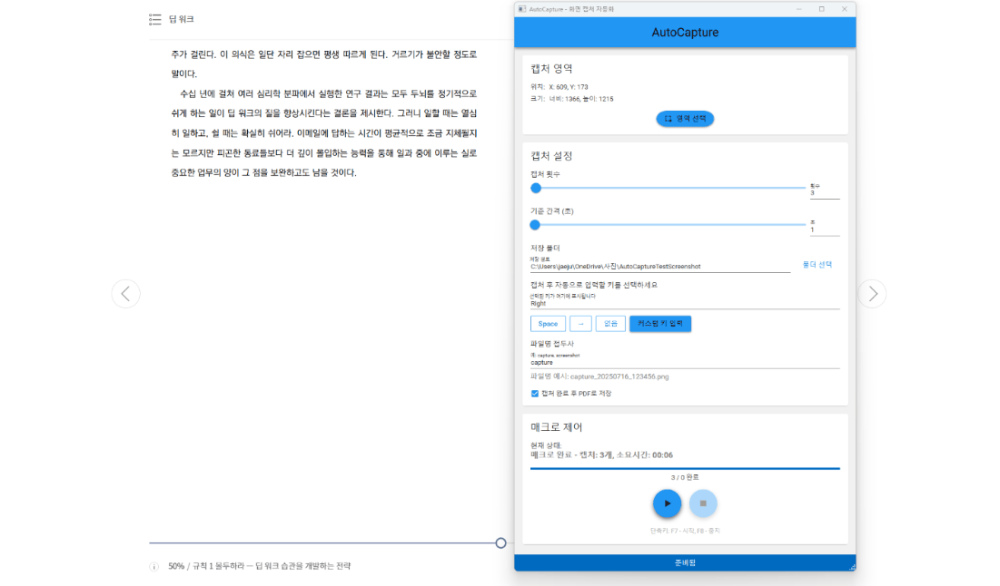

# AutoCapture

반복적인 화면 캡처와 페이지 전환 입력을 자동화하는 WPF 기반 데스크톱 도구입니다.  
사용자가 캡처 영역, 반복 횟수, 간격, 저장 경로, 입력 키를 설정하면 지정한 흐름대로 연속 캡처를 수행합니다.  
UI는 MVVM으로 분리하고, 실행 흐름은 `MacroEngine`에서 통합 관리하도록 설계했습니다.


_캡처 영역, 반복 횟수, 간격, 저장 경로, 자동 입력 키를 한 화면에서 설정할 수 있습니다._

## 핵심 문제와 해결

- 웹 뷰어나 문서 뷰어를 수십 장씩 캡처할 때, 매번 캡처 후 다음 페이지 키를 누르는 작업은 반복적이고 쉽게 실수할 수 있습니다.  
  이 프로젝트에서는 화면 저장과 페이지 전환 입력을 하나의 반복 흐름으로 묶어 수작업을 줄였습니다.

- 매크로가 실행되는 동안 메인 창이 화면을 가리거나 현재 진행 상태를 알기 어려우면 실제 사용성이 떨어집니다.  
  실행 중에도 현재 상태를 확인하고 제어할 수 있도록 화면 위쪽에 떠 있는 HUD와 전역 단축키를 함께 구성했습니다.

- 반복 캡처가 길어지면 메모리 사용량 증가나 파일 저장 실패 같은 문제가 누적될 수 있습니다.  
  반복 작업 중에도 문제를 확인할 수 있도록 재시도, 로그, 예외 처리 흐름을 함께 넣었습니다.

## 주요 기능



_시작 후 화면 캡처와 페이지 전환이 자동으로 반복되고, 진행 상태가 함께 갱신됩니다._

### 핵심 기능

- 창 위에서 클릭하면 창에 맞추고, 드래그로 직접 그리는 캡처 영역 선택
- 선택 후 손잡이로 크기 조절, Enter 확정, 툴바에서 바로 시작
- 페이지 저장이 성공하면 다음 장으로 전환하며, 마지막 장에서는 입력 종료
- 캡처 간격과 입력 타이밍 제어
- PNG 일괄 저장 및 선택적 PDF 묶음 저장
- 전역 단축키 `F7` 시작·재개, `F8` 중지


_전체 화면 오버레이에서 드래그로 원하는 캡처 영역만 지정할 수 있습니다._

### 보조 기능

- 마지막 저장 폴더와 자동 입력 키 복원
- `Space`, `Right`, 없음, 사용자 지정 키 선택 UI
- 실행 중 HUD(진행률, 남은 시간, 일시정지·재개·중지)와 완료 카드(폴더 열기, PDF 열기)
- 작업 표시줄 진행률 및 상태 표시, 오류 알림 창 표시
- ViewModel/Service 중심 테스트 코드 포함

## 기술 스택

- C#, .NET 10 LTS, WPF
- CommunityToolkit.Mvvm
  WPF에서 ViewModel 보일러플레이트를 줄이고, 화면 상태 변경과 커맨드 연결을 단순한 구조로 유지하기 위해 사용했습니다.
- WPF 내장 Fluent 테마(`ThemeMode="System"`)
  외부 UI 패키지 없이 Windows 11의 Mica 배경, 라이트·다크, 강조색을 OS 설정과 맞추기 위해 사용했습니다.
- Microsoft.Extensions.DependencyInjection + Serilog
  화면 로직과 실행 로직을 분리한 상태에서 서비스 조합을 단순하게 유지하고, 반복 실행 중 흐름과 오류를 파일 로그로 남기기 위해 사용했습니다.
- H.InputSimulator
  캡처 이후 페이지 전환 입력 같은 반복 입력을 애플리케이션 외부 대상에도 일관되게 전달하기 위해 사용했습니다.
- System.Drawing.Common + QuestPDF
  화면의 지정 영역을 즉시 픽셀 단위로 저장하고, 저장된 결과물을 후처리로 PDF로 묶는 흐름에 맞춰 사용했습니다.
- xUnit + Moq
  매크로 실행 순서, 서비스 호출, ViewModel 상태 변경처럼 UI 밖에서 검증 가능한 로직을 분리해 테스트하기 위해 사용했습니다.

## 테스트 범위

- `MacroEngine`
  반복 실행 흐름, 캡처 호출 횟수, 자동 입력 호출 여부, 중지 요청 처리 같은 서비스 오케스트레이션 로직을 검증했습니다.
- `ViewModels`
  설정값 변경, 커맨드 활성화 조건, 작업 표시줄 진행 상태 반영 같은 화면 상태 로직을 검증했습니다.
- `ErrorMessages / ExceptionHandler`
  예외별 사용자 메시지 매핑과 전역 예외 처리기의 기본 동작을 검증했습니다.
- PNG·PDF 산출물
  고정 이미지로 PNG의 크기와 픽셀을 검사하고, 생성한 PDF를 렌더링해 세 페이지의 색과 순서를 검증합니다. Windows 데스크톱에서의 실제 입력과 영역 선택은 별도로 확인합니다.

100페이지 회귀 테스트에서는 각 페이지의 번호를 픽셀 색으로 표현한 문서를 사용합니다. 엔진이 PNG 100장과 PDF 한 개를 실제로 기록하면, 각 PNG와 렌더링한 PDF 페이지에서 번호를 다시 읽어 1~100 순서를 검사합니다. 마지막 페이지에서 추가 입력이 없는지도 확인합니다. [100페이지 통합 테스트](AutoCapture.Tests/Services/ScreenCaptureServiceTests.cs)

## 실행 환경

- Windows x64에서 실행합니다. 캡처는 화면에 실제로 보이는 픽셀을 저장합니다.
- 영역을 선택하면 영역 중앙에 있는 창이 입력 대상으로 표시됩니다. 다른 창이 활성화되면 작업을 일시정지합니다. 대상 창을 다시 활성화하고 `F7`을 누르면 남은 저장 또는 전환 작업을 이어갑니다.
- 입력 키가 ‘없음’이면 지정한 영역을 주기적으로 저장합니다. 모니터가 여러 대면 영역 선택 화면에서 작업할 모니터를 선택할 수 있습니다.

## 아키텍처

프로젝트는 `Wpf / Tests` 두 영역으로 나뉘어 있으며, WPF 프로젝트 내부는 `Models / Services / ViewModels / Views / Controls`로 역할을 분리했습니다.

- `Models`
  캡처 영역, 캡처 설정, 매크로 상태, 오류 정보, 메시지 정의
- `Services`
  화면 캡처, 입력 시뮬레이션, 전역 단축키, 매크로 실행 엔진, 예외 처리
- `ViewModels`
  영역 선택, 캡처 설정, 매크로 제어, 메인 윈도우 상태 관리
- `Views / Controls`
  메인 화면, 영역 선택 오버레이, 실행 HUD, 알림창, 키 선택/키 캡처 UI
- `AutoCapture.Tests`
  서비스와 ViewModel의 동작 검증

요청 흐름 예시:

`View` -> `ViewModel` -> `MacroEngine` -> `ScreenCaptureService` / `InputService` -> `FileSystem`

핵심 원칙은 세 가지입니다.

- 화면 상태와 사용자 입력은 ViewModel에서 관리합니다.
- 실제 자동화 실행 순서와 오류 수집은 `MacroEngine`에 모읍니다.
- 캡처, 입력, 예외 처리, 단축키 등록은 각각 별도 서비스로 나눠 변경 범위를 줄입니다.

## 핵심 구현 상세

### 1. 서비스 오케스트레이션을 `MacroEngine`으로 분리

반복 캡처는 화면 저장, 입력 전송, 지연 처리, PDF 저장, 오류 수집처럼 여러 서비스가 순서와 조건에 따라 함께 동작해야 합니다.  
이 프로젝트에서는 이 흐름을 ViewModel에 넣지 않고 `MacroEngine`으로 분리해, UI는 상태와 커맨드에 집중하고 실제 실행 순서는 서비스 계층에서 조정하도록 구성했습니다.

### 2. 중지 요청과 실패 상황을 분리해 처리

엔진은 페이지 저장 결과를 확인한 후 다음 페이지 키를 보냅니다. 저장 재시도를 소진하면 해당 장에서 종료하고, 이미 저장한 PNG와 요청·시도·저장 수를 남깁니다. PDF 생성에 실패한 경우에도 PNG는 열 수 있습니다.

### 3. 실행 중 상태를 UI와 작업 표시줄에 동기화

자동화 도구는 실행 중 메인 창이 최소화되기 때문에, 화면 밖에서도 현재 상태를 알 수 있어야 합니다.  
이 프로젝트에서는 `MacroEngine` 이벤트를 ViewModel에 연결하고, 진행률과 상태 변화를 메시지로 전달해 작업 표시줄 진행률, 상태 메시지, HUD, 오류 알림 창이 같은 흐름을 기준으로 갱신되도록 구성했습니다.
HUD는 `WS_EX_NOACTIVATE`로 클릭해도 입력 대상 창의 포커스를 빼앗지 않고, `WDA_EXCLUDEFROMCAPTURE`로 캡처 영역과 겹쳐도 저장 이미지에 찍히지 않습니다.

## 실행 방법

### Windows 배포본

Windows CI가 성공하면 실행 결과의 `Artifacts → AutoCapture-win-x64`에서 자체 포함 배포본을 받을 수 있습니다. 압축을 풀고 같은 폴더에 있는 `AutoCapture.Wpf.exe`를 실행합니다. 해당 빌드를 로컬에서 만드는 명령은 다음과 같습니다.

```powershell
dotnet publish AutoCapture.Wpf -c Release -r win-x64 --self-contained true -o artifacts/AutoCapture-win-x64
```

### 소스에서 실행

```powershell
dotnet test AutoCapture.sln -c Release
dotnet run --project AutoCapture.Wpf
```

Windows와 .NET 10 SDK가 필요합니다. 저장 폴더와 영역을 선택하고 입력 대상과 반복 횟수를 확인한 뒤 시작 버튼 또는 `F7`을 누릅니다. 대상 창에서 `F7`로 재개하거나 `F8`로 중지할 수 있습니다. 실행 로그는 작업 디렉터리의 `logs/`에 기록됩니다. [Windows CI 설정](.github/workflows/windows.yml)

## 프로젝트 구조

```text
AutoCapture
├─ AutoCapture.Wpf
│  ├─ Controls
│  ├─ Models
│  ├─ Services
│  ├─ ViewModels
│  └─ Views
└─ AutoCapture.Tests
```
