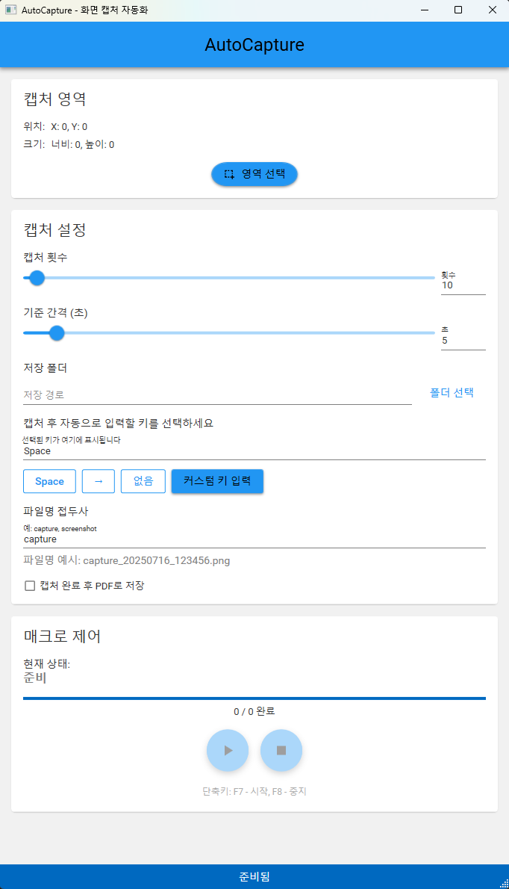
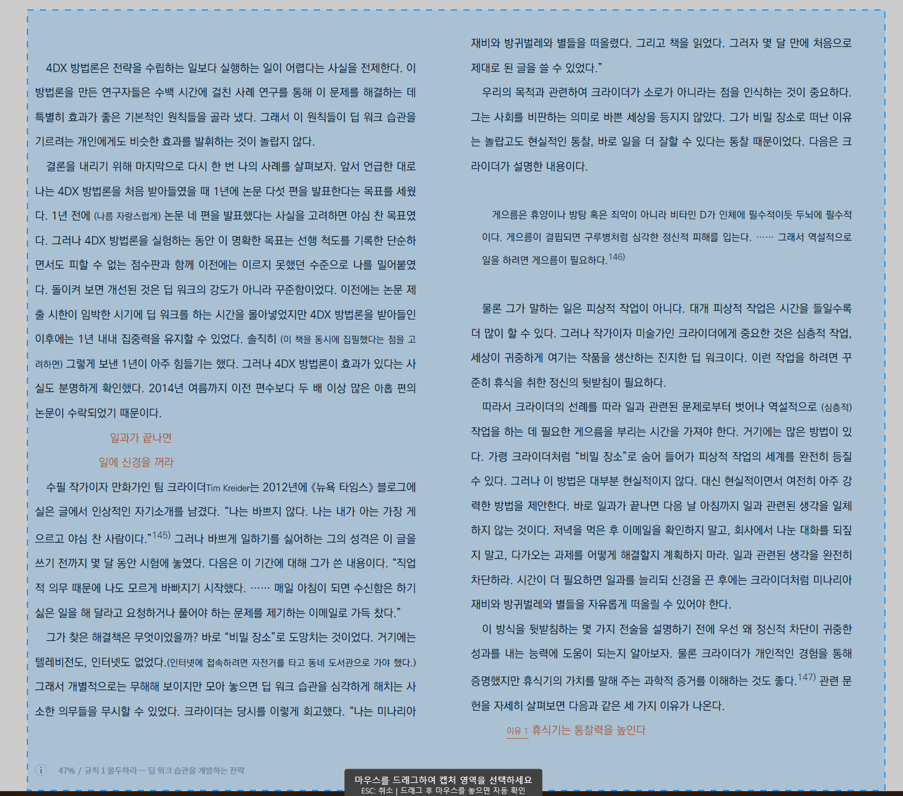

# AutoCapture

반복적인 화면 캡처와 페이지 전환 입력을 자동화하는 WPF 기반 데스크톱 도구입니다.  
사용자가 캡처 영역, 반복 횟수, 간격, 저장 경로, 입력 키를 설정하면 지정한 흐름대로 연속 캡처를 수행합니다.  
UI는 MVVM으로 분리하고, 실행 흐름은 `MacroEngine`에서 통합 관리하도록 설계했습니다.



_캡처 영역, 반복 횟수, 간격, 저장 경로, 자동 입력 키를 한 화면에서 설정할 수 있습니다._

## 핵심 문제와 해결

- 웹 뷰어나 문서 뷰어를 수십 장씩 캡처할 때, 매번 캡처 후 다음 페이지 키를 누르는 작업은 반복적이고 쉽게 실수할 수 있습니다.  
  이 프로젝트에서는 화면 저장과 페이지 전환 입력을 하나의 반복 흐름으로 묶어 수작업을 줄였습니다.

- 매크로가 실행되는 동안 메인 창이 화면을 가리거나 현재 진행 상태를 알기 어려우면 실제 사용성이 떨어집니다.  
  실행 중에도 현재 상태를 확인하고 제어할 수 있도록 진행률 표시, 알림, 전역 단축키를 함께 구성했습니다.

- 반복 캡처가 길어지면 메모리 사용량 증가나 파일 저장 실패 같은 문제가 누적될 수 있습니다.  
  반복 작업 중에도 문제를 확인할 수 있도록 재시도, 로그, 예외 처리 흐름을 함께 넣었습니다.

## 주요 기능


_시작 후 화면 캡처와 페이지 전환이 자동으로 반복되고, 진행 상태가 함께 갱신됩니다._

### 핵심 기능

- 드래그 기반 캡처 영역 선택
- 지정 횟수만큼 반복 캡처 후 자동 입력 키 전송
- 캡처 간격과 입력 타이밍 제어
- PNG 일괄 저장 및 선택적 PDF 묶음 저장
- 전역 단축키 `F7` 시작, `F8` 중지



_전체 화면 오버레이에서 드래그로 원하는 캡처 영역만 지정할 수 있습니다._

### 보조 기능

- 마지막 저장 폴더와 자동 입력 키 복원
- `Space`, `Right`, 없음, 사용자 지정 키 선택 UI
- 작업 표시줄 진행률 및 상태 표시
- 완료/오류 알림 창 표시
- ViewModel/Service 중심 테스트 코드 포함

## 기술 스택

- C#, .NET 8, WPF
- CommunityToolkit.Mvvm
  WPF에서 ViewModel 보일러플레이트를 줄이고, 화면 상태 변경과 커맨드 연결을 단순한 구조로 유지하기 위해 사용했습니다.
- MaterialDesignThemes
  설정 중심의 데스크톱 UI를 별도 디자인 시스템 없이도 일관된 컴포넌트와 스타일로 빠르게 구성하기 위해 사용했습니다.
- Microsoft.Extensions.DependencyInjection + Serilog
  화면 로직과 실행 로직을 분리한 상태에서 서비스 조합을 단순하게 유지하고, 반복 실행 중 흐름과 오류를 파일 로그로 남기기 위해 사용했습니다.
- H.InputSimulator
  캡처 이후 페이지 전환 입력 같은 반복 입력을 애플리케이션 외부 대상에도 일관되게 전달하기 위해 사용했습니다.
- System.Drawing.Common + QuestPDF
  화면의 지정 영역을 즉시 픽셀 단위로 저장하고, 저장된 결과물을 후처리로 PDF로 묶는 흐름에 맞춰 사용했습니다.
- xUnit + Moq
  매크로 실행 순서, 서비스 호출, ViewModel 상태 변경처럼 UI 밖에서 검증 가능한 로직을 분리해 테스트하기 위해 사용했습니다.

## 테스트 범위

- `MacroEngine`
  반복 실행 흐름, 캡처 호출 횟수, 자동 입력 호출 여부, 중지 요청 처리 같은 서비스 오케스트레이션 로직을 검증했습니다.
- `ViewModels`
  설정값 변경, 커맨드 활성화 조건, 작업 표시줄 진행 상태 반영 같은 화면 상태 로직을 검증했습니다.
- `ErrorMessages / ExceptionHandler`
  예외별 사용자 메시지 매핑과 전역 예외 처리기의 기본 동작을 검증했습니다.
- 제한 사항
  실제 화면 캡처, 일부 UI 상호작용, PDF 생성 일부 케이스는 실행 환경이나 네이티브 의존성 영향이 있어 제한적으로 검증하거나 `Skip` 처리했습니다.

## 실행 전제와 한계

- Windows 데스크톱 환경 전용
  전역 단축키 등록, 화면 캡처, 입력 시뮬레이션이 Windows API와 데스크톱 환경을 전제로 동작합니다.
- 포커스된 대상 창 기준 입력 전송
  자동 입력은 현재 활성화된 대상 창으로 전달되므로, 실행 중 포커스가 다른 창으로 이동하면 의도하지 않은 입력이 발생할 수 있습니다.
- 화면 환경 의존성
  캡처 영역 선택과 실제 저장 결과는 디스플레이 해상도, 배율, 실제 화면 표시 상태에 영향을 받습니다.
- PDF 생성 의존성
  PDF 저장은 동작하지만, 테스트 환경에서는 QuestPDF 네이티브 의존성 때문에 일부 케이스를 제한적으로만 검증했습니다.

## 아키텍처

프로젝트는 `Wpf / Tests` 두 영역으로 나뉘어 있으며, WPF 프로젝트 내부는 `Models / Services / ViewModels / Views / Controls`로 역할을 분리했습니다.

- `Models`
  캡처 영역, 캡처 설정, 매크로 상태, 오류 정보, 메시지 정의
- `Services`
  화면 캡처, 입력 시뮬레이션, 전역 단축키, 매크로 실행 엔진, 예외 처리
- `ViewModels`
  영역 선택, 캡처 설정, 매크로 제어, 메인 윈도우 상태 관리
- `Views / Controls`
  메인 화면, 영역 선택 오버레이, 알림창, 키 선택/키 캡처 UI
- `AutoCapture.Tests`
  서비스와 ViewModel의 동작 검증

요청 흐름 예시:

`View` -> `ViewModel` -> `MacroEngine` -> `ScreenCaptureService` / `InputService` -> `FileSystem`

핵심 원칙은 세 가지입니다.

- 화면 상태와 사용자 입력은 ViewModel에서 관리합니다.
- 실제 자동화 실행 순서와 오류 수집은 `MacroEngine`에 모읍니다.
- 캡처, 입력, 예외 처리, 단축키 등록은 각각 별도 서비스로 나눠 변경 범위를 줄입니다.

## 핵심 구현 상세

### 1. 서비스 오케스트레이션을 `MacroEngine`으로 분리

반복 캡처는 화면 저장, 입력 전송, 지연 처리, PDF 저장, 오류 수집처럼 여러 서비스가 순서와 조건에 따라 함께 동작해야 합니다.  
이 프로젝트에서는 이 흐름을 ViewModel에 넣지 않고 `MacroEngine`으로 분리해, UI는 상태와 커맨드에 집중하고 실제 실행 순서는 서비스 계층에서 조정하도록 구성했습니다.

### 2. 중지 요청과 실패 상황을 분리해 처리

반복 작업에서는 모든 오류를 즉시 중단으로 연결하면 사용성이 떨어지고, 반대로 모든 오류를 무시하면 상태를 잃기 쉽습니다.  
이 프로젝트에서는 취소 요청은 `CancellationToken`으로 루프를 중단하고, 캡처 실패처럼 복구 가능한 오류는 목록에 남긴 뒤 가능한 범위에서 다음 작업을 계속 진행하도록 나눴습니다.  
메모리 부족처럼 작업 지속이 위험한 경우에는 별도로 오류를 기록하고 실행을 중단하도록 구성했습니다.

### 3. 실행 중 상태를 UI와 작업 표시줄에 동기화

자동화 도구는 실행 중 메인 창이 최소화되기 때문에, 화면 밖에서도 현재 상태를 알 수 있어야 합니다.  
이 프로젝트에서는 `MacroEngine` 이벤트를 ViewModel에 연결하고, 진행률과 상태 변화를 메시지로 전달해 작업 표시줄 진행률, 상태 메시지, 완료/오류 알림 창이 같은 흐름을 기준으로 갱신되도록 구성했습니다.

## 실행 방법

### 권장 실행 경로

1. Windows 10/11 환경에서 Visual Studio 2022 또는 .NET 8 SDK가 준비된 상태를 권장합니다.
2. `AutoCapture.sln`을 열고 `AutoCapture.Wpf`를 시작 프로젝트로 실행합니다.
3. 앱에서 저장 폴더와 캡처 영역을 먼저 설정한 뒤, 캡처 횟수·간격·자동 입력 키를 지정하고 실행합니다.
4. 실행은 UI 버튼 또는 `F7`, 중지는 `F8`로 제어할 수 있습니다.

### 참고 경로

- 로그는 실행 폴더 기준 `logs/` 아래에 일자별로 기록됩니다.
- 예기치 않은 종료가 발생하면 `logs/crash_yyyyMMdd_HHmmss.log` 형식의 크래시 로그가 생성됩니다.
- 테스트는 `dotnet test AutoCapture.sln`으로 실행할 수 있으며, 일부 UI/PDF 관련 케이스는 환경 의존성 때문에 `Skip` 처리되어 있습니다.

### 데모 가능 범위

- Windows 데스크톱 환경에서는 영역 선택, 반복 캡처, 자동 키 입력, 로그 기록까지 기본 흐름을 데모할 수 있습니다.
- PDF 저장은 앱에서는 동작하도록 구성되어 있지만, 테스트 프로젝트에서는 QuestPDF 네이티브 의존성 때문에 일부 케이스가 `Skip` 처리되어 있습니다.
- 화면 캡처는 실제 디스플레이가 있는 환경에서 가장 안정적으로 동작합니다.

## 프로젝트 구조

```text
AutoCapture
├─ AutoCapture.Wpf
│  ├─ Controls
│  ├─ Models
│  ├─ Services
│  ├─ ViewModels
│  └─ Views
└─ AutoCapture.Tests
```
